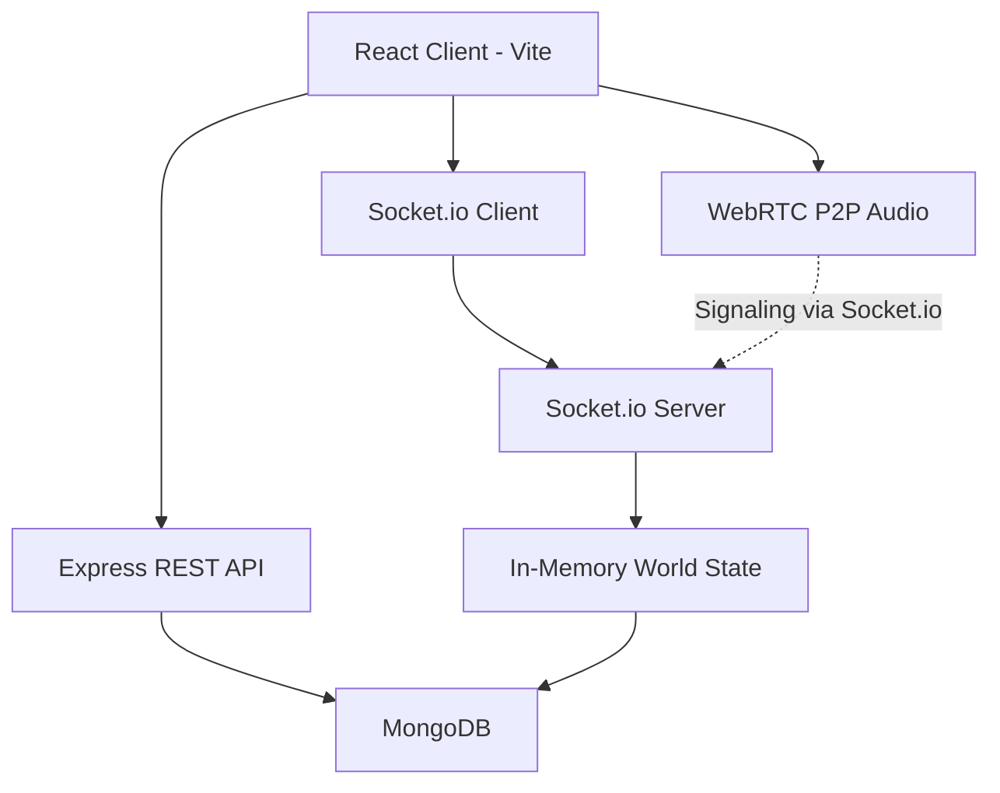

# ProxiSpeak – Geospatial Proximity Audio Ecosystem

**Project 2 | Infotact Solutions | Electronic City, Bengaluru, Karnataka | ISO 9001:2015 Certified**

[](https://nodejs.org/)
[](https://react.dev/)
[](https://www.mongodb.com/)
[](https://socket.io/)
[](https://webrtc.org/)
[](https://vitejs.dev/)

---

## Table of Contents

- [Overview](#overview)
- [Key Features](#key-features)
- [Tech Stack](#tech-stack)
- [Architecture](#architecture)
- [Project Structure](#project-structure)
- [Getting Started](#getting-started)
- [Environment Variables](#environment-variables)
- [Available Scripts](#available-scripts)
- [API Reference](#api-reference)
- [Realtime (Socket.io) Events](#realtime-socketio-events)
- [WebRTC Audio](#webrtc-audio)
- [Geospatial Engine](#geospatial-engine)
- [Themes](#themes)
- [Demo Accounts](#demo-accounts)
- [Troubleshooting](#troubleshooting)
- [Contributing](#contributing)
- [License](#license)

---

## Overview

**ProxiSpeak** reimagines remote collaboration by bringing the spontaneity of an in-person office to a virtual space. Instead of rigid breakout rooms where only one person speaks at a time, ProxiSpeak places users in a shared 2D overhead virtual office.

As avatars move closer together, audio dynamically crossfades and attenuates based on distance — just like overhearing conversations in a real office. You can naturally walk over to colleagues, form impromptu clusters, and have spatially-aware peer-to-peer conversations.

---

## Key Features

### Authentication & Identity
- **Secure Auth**: JWT-based authentication with bcrypt password hashing
- **Flexible Login**: Sign in with either email or username
- **Rich Onboarding**: Set name, workspace email, unique username/tag, role, avatar color, and avatar icon
- **Password Strength Meter**: Real-time feedback on password complexity
- **Demo Accounts**: One-click login for testing with pre-configured team members
- **Session Persistence**: Smart session resume with token validation
- **Forgot Password**: Modal-based password recovery flow

### 2D Virtual Office
- **Canvas Rendering**: Fully rendered HTML5 Canvas office at 60fps with smooth animations
- **Authentic Layout**: Four themed zones — *Spatial Audio Lab*, *Core WebRTC Bay*, *Product & Design Hub*, and *Breakout Lounge & Water Cooler*
- **Rich Environment**: Desks, server racks, whiteboards, lounge furniture, water coolers, and perimeter walls
- **Fluid Movement**: WASD/Arrow key controls with acceleration, friction, and normalized diagonal movement
- **Click-to-Walk**: Point-and-click navigation with smooth velocity easing
- **Theme Support**: Light and dark modes with live canvas theme switching

### Spatial Audio & Proximity
- **Proximity-Based Audio**: WebRTC peer connections established only within earshot radius (~100px)
- **Dynamic Attenuation**: Volume scales with distance using smooth falloff curves
- **3D-Style Panning**: Spatial audio positioning based on relative avatar locations
- **Speaking Indicators**: Visual rings show who's actively speaking
- **Proximity Clustering**: Real-time detection of conversation groups
- **Earshot Visualization**: Pulsing radius ring showing your audible range

### Realtime & Geospatial
- **Live Presence**: Socket.io-powered real-time position syncing
- **Geospatial Indexing**: MongoDB 2D planar index on user coordinates for efficient proximity queries
- **Coordinate Persistence**: Positions throttled and upserted to MongoDB
- **Graceful Fallback**: Works offline with simulated demo colleagues if backend is unavailable
- **Proximity API**: Query nearby users with clustering and performance benchmarking

---

## Tech Stack

| Layer | Technologies |
|---|---|
| **Frontend** | React 19, Vite 8, Tailwind CSS 4, Lucide React Icons |
| **Backend** | Node.js, Express 4, Socket.io 4 |
| **Database** | MongoDB with Mongoose ODM (2D geospatial indexing) |
| **Realtime** | Socket.io (WebSocket + polling fallback) |
| **Audio/RTC** | WebRTC (RTCPeerConnection), Web Audio API |
| **Auth** | JSON Web Tokens (JWT), bcryptjs |
| **Build Tools** | Vite, @tailwindcss/vite |

---

## Architecture



- **REST Layer**: Handles authentication, user management, and geospatial queries
- **Socket Layer**: Manages real-time presence, movement broadcasting, and WebRTC signaling
- **WebRTC Layer**: Establishes direct peer-to-peer audio connections between nearby users
- **Geospatial Layer**: Tracks coordinates in a 2D plane with MongoDB 2D indexing for spatial queries
- **State Management**: In-memory world state for low-latency realtime updates, persisted to MongoDB

---

## Project Structure

```
proxispeak/
├── package.json              # Root workspace scripts
├── README.md                 # Project documentation
├── client/                   # Frontend (React + Vite)
│   ├── index.html
│   ├── package.json
│   ├── vite.config.js        # Dev proxy to backend
│   ├── public/               # Static assets
│   └── src/
│       ├── App.jsx           # Main app router & state
│       ├── main.jsx          # Entry point
│       ├── index.css         # Global styles & theme tokens
│       ├── components/       # UI components
│       │   ├── LoginPage.jsx
│       │   ├── SignUpPage.jsx
│       │   ├── WorldCanvas.jsx      # Main office canvas & movement
│       │   ├── Navbar.jsx
│       │   ├── ProfilePanel.jsx
│       │   ├── ProximityRadarPreview.jsx
│       │   └── ForgotPasswordModal.jsx
│       └── hooks/            # Custom hooks
│           ├── useWorldSocket.js    # Socket.io world connection
│           └── useWebRTC.js         # WebRTC P2P audio logic
└── server/                   # Backend (Node + Express)
    ├── server.js             # Entry point & Socket.io setup
    ├── package.json
    ├── .env                  # Environment config
    ├── middleware/
    │   └── auth.js           # JWT authentication
    ├── models/
    │   └── User.js           # User schema with geospatial index
    ├── routes/
    │   ├── auth.js           # Auth endpoints
    │   └── world.js          # World/geospatial endpoints
    └── realtime/
        ├── worldState.js     # In-memory player state
        └── worldSocket.js    # Socket.io event handlers
```

---

## Getting Started

### Prerequisites

- [Node.js](https://nodejs.org/) v18+ (v20+ recommended)
- [npm](https://www.npmjs.com/) v9+
- [MongoDB](https://www.mongodb.com/) (optional - app runs in memory mode if unavailable)

### Installation

1. **Clone the repository**
   ```bash
   git clone <repository-url>
   cd infotact_project_2-Raghavendra-Patne
   ```

2. **Install all dependencies**
   ```bash
   npm run install:all
   ```
   Or install separately:
   ```bash
   # Backend
   cd server && npm install
   
   # Frontend
   cd ../client && npm install
   ```

3. **Configure environment variables** (see [Environment Variables](#environment-variables))

4. **Start the application**

   **Option 1: Run from root (recommended)**
   ```bash
   # Terminal 1 - Backend
   npm run server
   
   # Terminal 2 - Frontend
   npm run client
   ```

   **Option 2: Run individually**
   ```bash
   # Backend (from server/)
   npm start
   # or with auto-reload
   npm run dev
   
   # Frontend (from client/)
   npm run dev
   ```

5. **Access the app**
   - Frontend: [http://localhost:3000](http://localhost:3000)
   - Backend API: [http://localhost:5001](http://localhost:5001) (or as configured)
   - Health Check: [http://localhost:5001/api/health](http://localhost:5001/api/health)

---

## Environment Variables

Create/update `server/.env`:

```env
PORT=5001
MONGODB_URI=mongodb://127.0.0.1:27017/proxispeak
JWT_SECRET=your_secure_jwt_secret_here
```

| Variable | Default | Description |
|---|---|---|
| `PORT` | `5000` | Backend server port (Vite proxies to 5001 by default in config) |
| `MONGODB_URI` | `mongodb://127.0.0.1:27017/proxispeak` | MongoDB connection string |
| `JWT_SECRET` | `proxispeak_secret_jwt_key_2026` | Secret key for signing JWT tokens |

> **Note:** If MongoDB is not running, the app automatically falls back to in-memory storage. Demo accounts and all features remain functional.

---

## Available Scripts

### Root
| Script | Description |
|---|---|
| `npm run server` | Start backend server from root |
| `npm run client` | Start frontend dev server from root |
| `npm run install:all` | Install dependencies for both client and server |

### Server (`/server`)
| Script | Description |
|---|---|
| `npm start` | Start production server |
| `npm run dev` | Start with Node.js watch mode |

### Client (`/client`)
| Script | Description |
|---|---|
| `npm run dev` | Start Vite dev server on port 3000 |
| `npm run build` | Build for production |
| `npm run preview` | Preview production build |

---

## API Reference

Base URL: `http://localhost:5001/api`

### Authentication

| Method | Endpoint | Auth | Description |
|---|---|---|---|
| `POST` | `/auth/register` | No | Register a new user with spatial identity |
| `POST` | `/auth/login` | No | Login with email/username and password |
| `GET` | `/auth/me` | Yes (JWT) | Get current authenticated user profile |
| `GET` | `/auth/demo-accounts` | No | Get list of available demo accounts |

### World & Geospatial

| Method | Endpoint | Auth | Description |
|---|---|---|---|
| `GET` | `/world/bounds` | No | Get office canvas dimensions |
| `GET` | `/world/online` | No | Get currently online players snapshot |
| `GET` | `/world/nearby` | No | Find users near a point using geospatial query |
| `GET` | `/world/benchmark` | No | Run spatial clustering performance benchmark |

### System

| Method | Endpoint | Auth | Description |
|---|---|---|---|
| `GET` | `/health` | No | Health check with DB status |

#### Example: Nearby Query
```http
GET /api/world/nearby?x=300&y=250&radius=100
```

**Response:**
```json
{
  "success": true,
  "radius": 100,
  "source": "mongodb|memory",
  "elapsedMs": 2.341,
  "count": 3,
  "groups": [...],
  "users": [...]
}
```

---

## Realtime (Socket.io) Events

### Client → Server

| Event | Payload | Description |
|---|---|---|
| `world:join` | `{ id, name, username, role, department, avatarColor, avatarIcon, x, y }` | Join the virtual office |
| `world:move` | `{ x, y }` | Broadcast position update (throttled client-side) |
| `world:status` | `{ status }` | Update status (`online`, `idle`, `in-meeting`) |
| `world:leave` | `{}` | Leave the office gracefully |
| `world:offer` | `{ target, offer }` | WebRTC SDP offer |
| `world:answer` | `{ target, answer }` | WebRTC SDP answer |
| `world:ice-candidate` | `{ target, candidate }` | WebRTC ICE candidate |

### Server → Client

| Event | Payload | Description |
|---|---|---|
| `world:state` | `{ bounds, selfId, players[] }` | Full world snapshot on join |
| `world:player-joined` | `{ id, name, ..., x, y }` | New player entered |
| `world:player-moved` | `{ id, x, y }` | Player position updated |
| `world:player-left` | `{ id }` | Player disconnected |
| `world:player-status` | `{ id, status }` | Player status changed |
| `world:presence` | `{ count }` | Online count update |
| `world:proximity-update` | `{ timestamp, players[] }` | Proximity groups recalculated |
| `world:offer` | `{ from, offer }` | Forwarded SDP offer |
| `world:answer` | `{ from, answer }` | Forwarded SDP answer |
| `world:ice-candidate` | `{ from, candidate }` | Forwarded ICE candidate |

---

## WebRTC Audio

ProxiSpeak uses a robust WebRTC implementation with the following design principles:

- **Proximity-Gated**: Connections only established when peers are within `EARSHOT` radius (100px)
- **Deterministic Negotiation**: The peer with the lexicographically smaller ID initiates the offer to prevent glare
- **Single Transceiver**: Uses `addTransceiver` with `sendrecv` direction to avoid renegotiation
- **Stable Signaling**: Proper rollback handling for glare scenarios
- **Distance-Based Attenuation**: Remote audio volume scales with proximity
- **Speaking Detection**: RMS analysis of audio streams drives visual indicators
- **Graceful Fallback**: Handles autoplay policies and connection failures
- **Diagnostics**: Built-in connection state monitoring and debugging tools

**Default ICE Servers:** Google STUN servers (`stun:stun.l.google.com:19302`)

---

## Geospatial Engine

- **Coordinate System**: 2D Cartesian plane matching HTML5 Canvas pixel coordinates
- **Index Type**: MongoDB `2d` planar index on `User.location` with bounds `[-1000, 10000]`
- **Query Methods**: 
  - `$near` - Find users sorted by distance from a point
  - In-memory clustering for group detection
- **Clustering Algorithm**: Union-Find (disjoint set) for grouping users within radius
- **Persistence**: Positions upserted every ~2.5s to avoid DB hammering
- **Fallback**: In-memory spatial queries when MongoDB is unavailable

---

## Themes

ProxiSpeak supports light and dark themes with live switching:

- **Dark Mode** (default): Deep slate/navy theme optimized for low-light environments
- **Light Mode**: Clean blueprint-white theme with high contrast

Theme preference is saved to `localStorage` and applied globally across all UI components and the canvas.

---

## Demo Accounts

Quick login credentials for testing (password: `password123`):

| Name | Email/Username | Role | Department | Color |
|---|---|---|---|---|
| Dr. Aris Thorne | `aris@infotact.in` / `aris_infotact` | Audio Engineer | Spatial Audio Lab | `#6366f1` (Indigo) |
| Priya Sharma | `priya@infotact.in` / `priya_dev` | Developer | Core WebRTC Team | `#10b981` (Emerald) |
| Rohan Mehta | `rohan@infotact.in` / `rohan_lead` | Product Manager | Product & Design | `#f59e0b` (Amber) |

These accounts are auto-seeded on server startup.

---

## Troubleshooting

| Issue | Solution |
|---|---|
| **Port already in use** | Change `PORT` in `server/.env` or kill the process using that port |
| **MongoDB connection fails** | App runs in fallback mode automatically. Install/start MongoDB or ignore if testing offline |
| **No audio in WebRTC** | Allow microphone permissions, click to resume audio (autoplay policy), check if peers are in earshot |
| **Can't move/connect** | Check if backend is running, verify Socket.io connection in browser dev tools |
| **Vite proxy errors** | Ensure backend port matches `vite.config.js` proxy target (default 5001) |
| **CORS issues** | Backend has CORS enabled for all origins in dev mode |
| **Canvas not rendering** | Check browser console for errors, ensure WebGL/Canvas is supported |

### Debug Tools

In the browser console:
```javascript
// Check WebRTC state
window.__proxispeakRtc.snapshot()
```

---

## Contributing

This project was developed as part of **Infotact Solutions Project 2**. For contributions or modifications:

1. Follow existing code style and patterns
2. Keep changes consistent with the architecture
3. Test with both MongoDB connected and disconnected modes
4. Ensure WebRTC works across different network conditions
5. Update documentation for new features

---

## License

**ISC License** © 2026 Infotact Solutions

---

**Built with ❤️ by the Infotact Solutions Team** | *Bringing spatial presence to remote collaboration*
